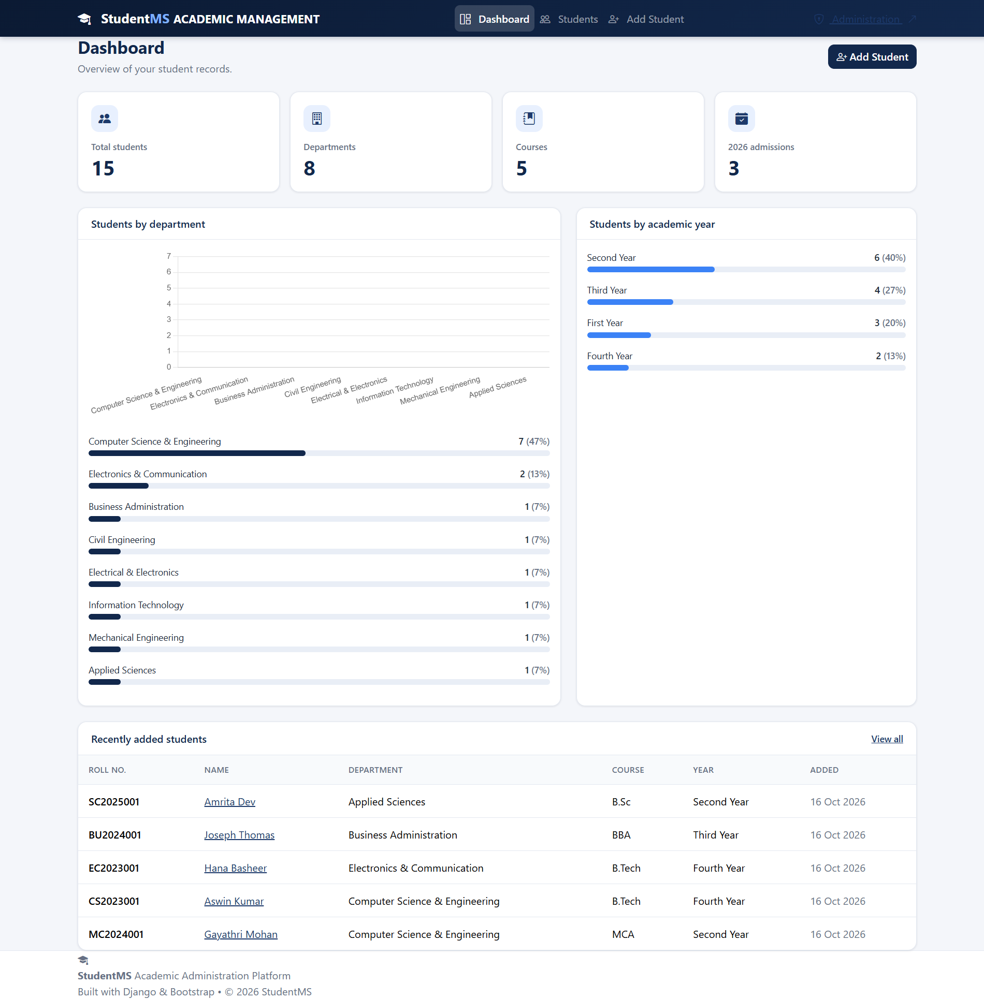
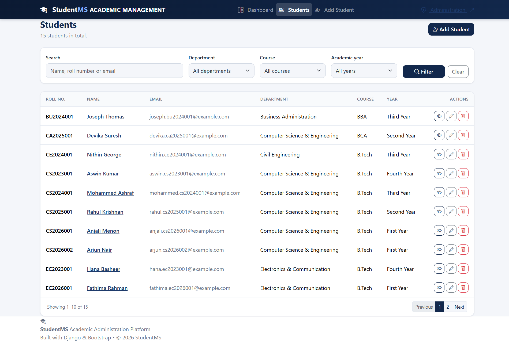
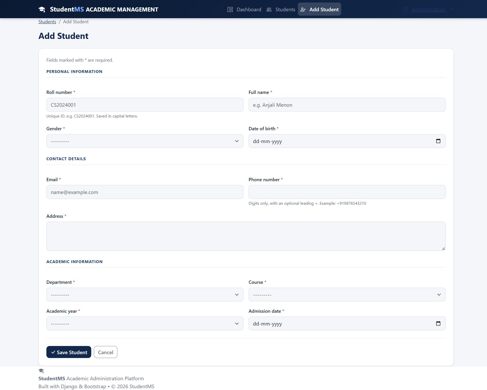
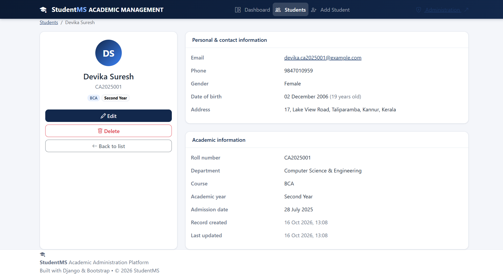

# Student Management System

A responsive Student Management System built with **Python, Django, SQLite, HTML, CSS, and Bootstrap 5**. This application helps manage student records through a clean dashboard and an easy-to-use interface.

## Screenshots

### Dashboard


### Student List


### Add Student


### Edit Student


## Features

- Dashboard with student statistics
- Add, view, edit, and delete student records
- Search students by name, roll number, or email
- Filter students by department, course, and year
- Pagination for student records
- Form validation
- Django administration panel
- Responsive interface using Bootstrap 5

## Technologies Used

- **Backend:** Python, Django
- **Database:** SQLite
- **Frontend:** HTML, CSS, Bootstrap 5
- **Tools:** Visual Studio Code, Git, GitHub

## Getting Started

### Prerequisites

- Python 3.10 or later, compatible with your installed Django version
- Git

### Installation

1. Clone the repository:

   ```bash
   git clone https://github.com/SreedeviKV13/django-student-management-system.git
   ```

2. Navigate to the project folder:

   ```bash
   cd django-student-management-system
   ```

3. Create a virtual environment:

   ```bash
   python -m venv venv
   ```

4. Activate the virtual environment on Windows:

   ```powershell
   .\venv\Scripts\Activate.ps1
   ```

5. Install dependencies:

   ```bash
   pip install -r requirements.txt
   ```

6. Apply database migrations:

   ```bash
   python manage.py migrate
   ```

7. Start the development server:

   ```bash
   python manage.py runserver
   ```

8. Open the application in your browser:

   http://127.0.0.1:8000/

## Project Structure

```text
student_management_system/
├── config/
├── students/
├── templates/
├── static/
├── screenshots/
├── manage.py
├── requirements.txt
├── .gitignore
└── README.md
```

*Note: The folder structure above is illustrative. Adjust it to match your actual project.*

## Learning Objectives

This project demonstrates practical experience with Django models, views, templates, forms, CRUD operations, database migrations, search, filtering, pagination, and responsive web design.

## Author

**Sreedevi K. V.**

- GitHub: [@SreedeviKV13](https://github.com/SreedeviKV13)

---

If you find this project useful, consider giving the repository a star!